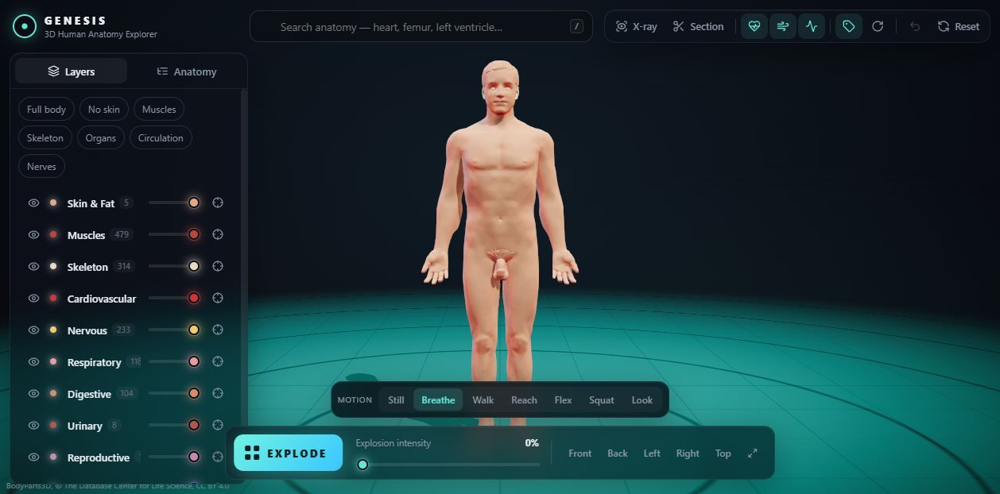
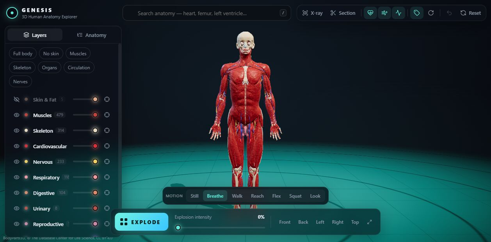
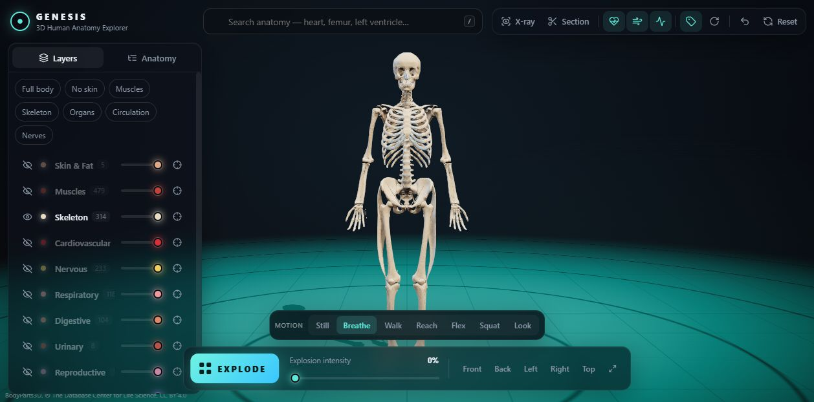
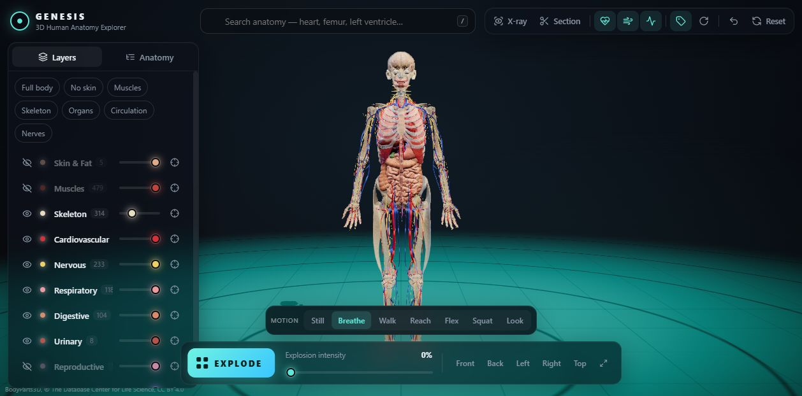
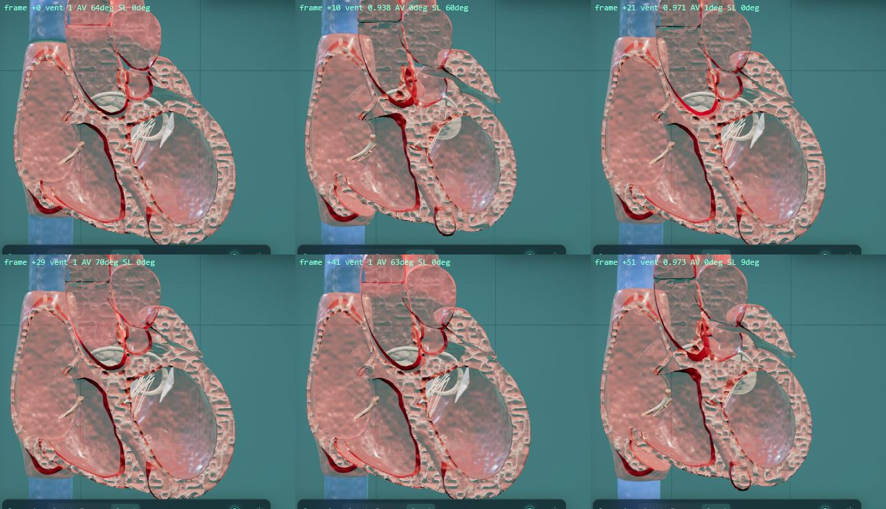
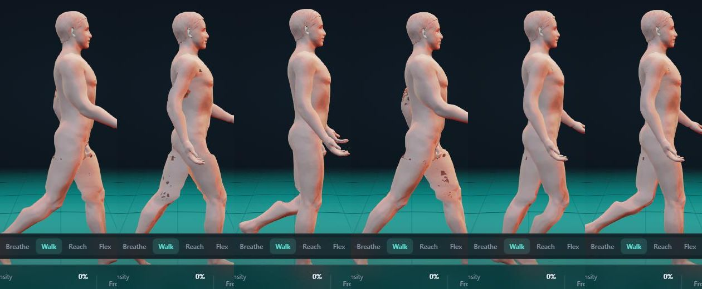

# Genesis — Living 3D Human Anatomy

An interactive, animated 3D human body in the browser. Real anatomical meshes (BodyParts3D) are rigged to a 120-bone skeleton so the whole body — skin, muscles, bones, vessels, organs — breathes, beats, blinks, walks and reacts, and can be dissected layer by layer, exploded, sectioned and searched.

Built with React, TypeScript, Three.js and React Three Fiber.



| Muscles | Skeleton | Organs |
|---|---|---|
|  |  |  |




## Features

- **Real anatomy** — ~2,200 BodyParts3D structures (skin, 479 muscles, 314 bones incl. every hand/foot bone and teeth, ~900 arteries and veins, heart, brain gyri, organs) with their anatomical names.
- **Hybrid model** — structures missing from the dataset (lung lobes, whole liver, spinal cord, peripheral nerves, lymphatic system, tendons and ligaments, animated heart-valve leaflets) are generated procedurally and fitted onto the real body with a thin-plate-spline landmark warp (165 landmark pairs, 5.5 mm RMS).
- **Living body** — one skeleton drives every mesh through GPU skinning:
  - breathing with rib bucket- and pump-handle motion, sternum and diaphragm excursion;
  - heartbeat (68 bpm) with atrial then ventricular contraction and valves opening and closing on the cardiac cycle;
  - blinks and saccades, idle sway, and motion modes: Walk, Reach, Flex, Squat, Look;
  - muscles bulge when they contract, soft tissue ripples when poked, a patellar knee-jerk reflex, peristalsis and illustrative blood-flow pulses.
- **Exploration** — layer toggles and opacity, hierarchy tree, search, isolate, hide, transparency, X-ray, cross-section clipping, global and per-organ explode, floating labels, undo.

## Run

```bash
npm install
npm run dev          # http://localhost:5173
npm run build        # production bundle
npm run preview      # serve the production bundle (faster loading)
```

The converted meshes are committed in `public/bp3d/` (~68 MB), so the app runs straight after `npm install`.

## Rebuilding the anatomy data

`public/bp3d/*.bin` and `src/data/bp3d_manifest.json` are generated from the BodyParts3D 4.0 OBJ archive:

1. Download `isa_BP3D_4.0_obj_99.zip` and the `isa_*` text files from the [BodyParts3D download page](https://dbarchive.biosciencedbc.jp/en/bodyparts3d/download.html) into `data/bp3d/` and unzip there.
2. `node scripts/bp3d/run_all.cjs` — classifies every mesh, fits the landmark warp, converts and decimates the meshes, computes skin weights, writes the binaries and manifest, then validates them.

## Project layout

| Path | Contents |
|---|---|
| `src/anatomy/` | anatomy registry, procedural structures, BodyParts3D integration, skeleton definition |
| `src/geo/` | signed-distance-field modelling, Surface Nets mesher, tubes, branching, landmark warp, skin weights |
| `src/scene/` | viewer, materials and shaders, motion and physiology driver, runtime |
| `src/ui/` | interface panels |
| `scripts/bp3d/` | data pipeline |
| `docs/SPEC.md` | design spec |

## Credits

Anatomical mesh data: **BodyParts3D, © The Database Center for Life Science, licensed under [CC Attribution 4.0 International](https://creativecommons.org/licenses/by/4.0/)**. The meshes were transformed, decimated and rigged for this project.
